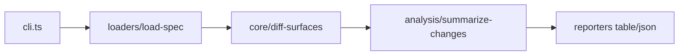

# hx-api-diff-cli — architecture

## Purpose

Loads two OpenAPI 3 specifications (JSON or YAML), extracts a normalized **API surface**
(operations, methods, security), and emits a structured change list suitable for release
reviews and offensive prep. Non-goals: runtime API probing, GraphQL, or Swagger 2.

## High-level flow

## Module map

| Path                                | Responsibility                                    |
| ----------------------------------- | ------------------------------------------------- |
| `src/cli.ts`                        | Commander `diff` command, flags, exit codes       |
| `src/loaders/load-spec.ts`          | Read file, parse JSON/YAML → `ApiSurface`         |
| `src/core/extract-operations.ts`    | Flatten `paths` into operation refs               |
| `src/core/diff-surfaces.ts`         | Compare surfaces → `ApiChange[]`                  |
| `src/analysis/summarize-changes.ts` | Summary counts, report builder, exit policy       |
| `src/reporters/`                    | Table (chalk) and JSON serializers                |
| `src/utils/`                        | Operation keys, HTTP method guard, format helpers |

## Extension

1. Add a new change class in `diff-surfaces.ts` (e.g. parameter requiredness).
2. Extend `summarize-changes.ts` severity / exit mapping if the change is breaking.
3. Add unit tests with fixture specs under `tests/` — no live network.
4. Run `npm test` and `npm run format:check`.

## Testing strategy

- **Unit**: loaders, diff logic, reporters, utils (`*.spec.ts` co-located with modules).
- **Integration**: `tests/diff.test.ts` smoke on sample fixtures.

## Ethics & scope

Authorized engagements only. See [SECURITY.md](./SECURITY.md).
